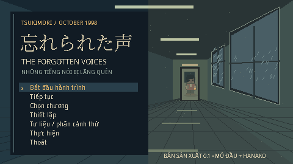

# 3DPsychocal · 忘れられた声

**Wasurerareta Koe / The Forgotten Voices / Những Tiếng Nói Bị Lãng Quên**

Một game **2D pixel art**, Python 3.12 + Pygame CE, chạy offline. Tsukimori, tháng 10 năm 1998. Ren về quê thăm mẹ nhập viện và giải quyết giấy tờ căn nhà. Anh chỉ xin nghỉ ba ngày.



## Trạng thái thật của bản giao

**Bản sản xuất 0.1, không phải game đầy đủ 9–12 giờ.** Theo điều khoản chia giai đoạn của V1 §15 và V2 §XV, bản này bàn giao một tuyến chơi khép lại ở cuối Hanako và nền tảng để tiếp tục sản xuất. Không có cam kết thời lượng chơi chưa đo.

| Hạng mục | Có trong repo | Chơi được trong bản này |
|---|---:|---:|
| Câu đố có dữ liệu riêng | 100, P001–P100 | 22: mở đầu + Hanako |
| Hồ sơ nhân vật | 25 | 8 có lời thoại trong tuyến chơi |
| Cuộc thoại | 25 | 8 |
| Lời thoại tiếng Việt, đếm theo khoảng trắng | 3.914 | 1.246 |
| Bản đồ có collision | 5 | 5 |
| Kết thúc | 5 quy tắc + 5 chuỗi xem thử | Chưa thể đạt từ campaign |
| Đồ họa / âm thanh | PNG, atlas, WAV, font, trình sinh | Có |

**Chưa đạt:** 100 câu đố có cơ chế hoàn thiện, campaign II–VI, 9–12 giờ / 15–20 giờ có playtest, ending kiếm được trong campaign, bản dịch Anh/Nhật, cinematic chuyển nhân vật, truy đuổi, art và âm thanh cấp phát hành. Phân loại câu đố hiện chưa đúng ngân sách 35/20/20/15/10; số thực nằm trong báo cáo. Phần thiết kế không được cộng vào số tính năng đã triển khai.

## Chạy ngay từ source

Python **3.12** hoặc **3.13**, Windows/Linux. Không cần editor game.

```sh
python -m venv .venv
# Windows: .venv\Scripts\activate
# Linux/macOS: source .venv/bin/activate
python -m pip install -r requirements.txt
python main.py
```

Sau khi cài thư viện, game không cần mạng, tài khoản hay API. Assets đã có sẵn, không phải chạy trình sinh để chơi. Trên Windows có thể dùng `run_windows.bat` để tạo môi trường và mở game lần đầu.

## Điều khiển

| Phím | Tác dụng |
|---|---|
| WASD / mũi tên | Di chuyển |
| Shift | Chạy |
| E / nhấp trái khi đứng gần | Xem vật, nói chuyện, đi qua lối ra |
| Enter | Tiếp hội thoại, gửi đáp án |
| 1 / 2 | Chọn phản hồi khi hội thoại kết thúc |
| J | Sổ: ← → đổi mục, ↑ ↓ đổi trang |
| Space / C trong mục Chứng cứ | Chọn hai tài liệu / ghép giả thuyết |
| Tab | Túi đồ; vật phẩm dùng theo ngữ cảnh |
| M | Hiện tại / hồi tưởng, sau khi nghe cassette |
| H trong câu đố | Ba cấp gợi ý |
| F sau ba lần sai | Bỏ qua có ghi nhận, không khóa truyện |
| F5 / F9 | Lưu / tải, chọn trang 1–3 |
| Esc | Khép bảng / tạm dừng |

Các phím E, J, Tab, M có thể đổi trong Thiết lập. Menu hỗ trợ chuột; giải đố và sổ ưu tiên bàn phím. Không có chiến đấu. Sau câu đố cuối, quay lại phố hoặc xem tư liệu sản xuất từ menu. `Chọn chương` chỉ mở Hanako nếu autosave đã hoàn thành phần mở đầu.

**Lưu game:** Windows `%LOCALAPPDATA%\3DPsychocal`; Linux `~/.local/share/3DPsychocal`. Có autosave và ba trang thủ công, ghi tệp nguyên tử. Save lỗi được báo và giữ nguyên. Có thể chọn thư mục khác qua `--user-dir PATH` hoặc `FORGOTTEN_VOICES_USER_DIR`. Log ở cùng thư mục.

**Hỗ trợ tiếp cận:** phụ đề cho nhịp gõ, giảm xuất hiện bất ngờ, tắt mưa chuyển động, CRT tùy chọn, toàn màn hình, âm lượng độc lập. Bản hiện tại không có chớp đèn mạnh, máu hoặc lồng tiếng; các mục giảm chớp/máu/voice là cấu hình dự phòng, không được tính là nội dung đã có.

## Kiểm thử và build

```sh
python -m pip install -r requirements-dev.txt
python tools/validate_content.py
python -m pytest -q
python tools/playtest_route.py
python main.py --headless --frames 120 --user-dir work/smoke
```

Windows: chạy `build_windows.bat`. Đầu ra là `dist/3DPsychocal/3DPsychocal.exe` cùng thư mục `_internal`. Phải giữ **toàn bộ thư mục**, không chép riêng EXE. Không cần Python trên máy chơi.

CI [build.yml](.github/workflows/build.yml) chạy trên Ubuntu và Windows, kiểm tra source, đóng gói rồi smoke-test chương trình Windows. Xem trạng thái thật trong [reports/QA.md](reports/QA.md); sự tồn tại của script build không chứng minh EXE đã được kiểm thử. Không dùng PyInstaller Linux để giả tạo EXE Windows.

ZIP source có thể tải bằng **Code → Download ZIP** trên nhánh chứa bản giao. Bản phát hành/build artifact chỉ có nếu workflow thành công. `python tools/package_source.py` tạo ZIP riêng và loại save, cache, venv, build.

## Nội dung repo

- `core/`: game loop, asset paths, state, JSON registry, điều phối giao diện.
- `systems/`: tiến trình, quan hệ, chứng cứ, ending rules, save validation, world/collision, audio.
- `scenes/`: renderer pixel, chữ bitmap không làm mịn, integer scaling 480×270.
- `data/`: 100 puzzle records, 25 profiles, 25 dialogues, 5 maps, quests, 5 ending previews.
- `assets/`: sprite sheets bốn hướng, portraits ba biểu cảm, props, tiles, background, icon, font và PCM WAV.
- `tools/`: asset generator, validator, kiểm thử tuyến UI, báo cáo graph, đóng gói.
- `docs/`: GDD, Story Bible, Truth Matrix, art bible, roadmap, yêu cầu nguồn.
- `reports/`: kết quả thật, ảnh render, số lượng; không phải ước lượng hoàn thành.

Bắt đầu từ [GDD](docs/GDD.md), [Story Bible](docs/STORY_BIBLE.md), [ma trận sự thật](data/truth_matrix.json), [tiến độ yêu cầu](docs/REQUIREMENTS.md) và [lộ trình tiếp tục](docs/ROADMAP.md).

## Nguồn gốc tài nguyên

Mã và nội dung gốc theo [Apache-2.0](LICENSE). PNG pixel và WAV tổng hợp được tạo riêng bằng `tools/generate_assets.py`, dùng cùng giấy phép. Font Noto theo SIL OFL, bản quyền đầy đủ tại `assets/fonts/`. Không dùng asset lấy từ game thương mại.

Alpix đã mở canvas; không có file xuất từ canvas được dùng. AutoSprite đã tạo bản ghi nhân vật Ren nhưng chưa trả về ảnh; **không có sprite AutoSprite trong runtime**. Chi tiết trung thực ở [ASSET_PROVENANCE](docs/ASSET_PROVENANCE.md). Game không cần hai dịch vụ này để chạy.

Tsukimori và Kiroku là hư cấu. Các truyền thuyết là chất liệu kể chuyện, không phải bằng chứng về sự kiện có thật ở Nhật Bản.
